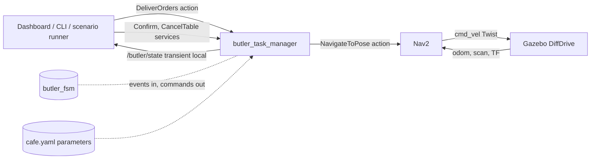
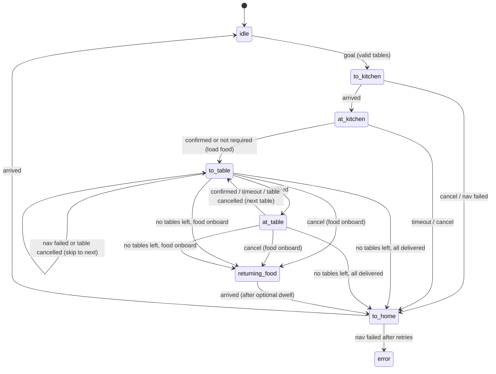

# Architecture

## 1. Environment this design targets

Checked on the development machine (2026-11-02).

| Item | Finding | Consequence |
|---|---|---|
| OS and ROS | Ubuntu 24.04, ROS 2 Jazzy | The first submission targeted ROS 1 and Gazebo Classic. All of it is rewritten ([migration.md](migration.md)) |
| Simulator | Gazebo Harmonic (`gz sim` 8.15), `ros_gz_sim` 1.0.24, `ros_gz_bridge` | SDF worlds and the `gz-sim` system plugins replace Gazebo Classic's `libgazebo_ros_*` plugins |
| Navigation | Nav2 1.3.13 (`nav2_bringup`, AMCL, map server, planners, controllers) | Nav2's `NavigateToPose` action is the only navigation interface. No custom planner |
| Velocity type | Nav2 on Jazzy publishes `geometry_msgs/Twist` on `cmd_vel` (its Jazzy params have no stamped option). To be confirmed again in M3 | The bridge maps `/cmd_vel` as `Twist` to the Gazebo `DiffDrive` plugin |
| Other packages present | `slam_toolbox`, `behaviortree_cpp` 4.10, `diff_drive_controller`, `gz_ros2_control` | `slam_toolbox` makes the map once. `behaviortree_cpp` is a stretch option (M9). `gz_ros2_control` is not needed: Gazebo's own `DiffDrive` system drives the wheels |
| Toolchain | Python 3.12, `rclpy`, `pytest`, `colcon`, CMake 3.28 (interfaces only), Docker | Nodes are Python (D6) |

## 2. Design decisions

| # | Decision | Reason |
|---|---|---|
| D1 | Task logic is a **ROS-free Python module** (`butler_fsm`) driven by events and returning commands. A thin `rclpy` node wraps it | The graded part of the assessment is the behaviour. As a pure module, every requirement R1 to R7 becomes a fast, deterministic `pytest` with no simulator. This is also what the first submission lacked |
| D2 | Orders come through the `DeliverOrders` **action**; confirmations and table cancels are **services**; state is a **latched topic** | Each ROS concept used for what it is meant for: long task with feedback and cancellation, short request with an answer, state that late subscribers must see |
| D3 | Navigation goes only through Nav2's `NavigateToPose` action | Reuses a tested stack. The node never publishes `cmd_vel` |
| D4 | Locations, tables, timeouts, and confirmation switches are **parameters** loaded from one YAML file | "Generic, not hardcoded". A fourth table is a YAML edit |
| D5 | "Food onboard, so return to the kitchen" is **one rule** in the state machine, not one special case per requirement | Fewer branches, no per-scenario code, matches the wording of the PDF |
| D6 | Everything is Python with `rclpy`, except the interfaces package, which must be `ament_cmake` because `rosidl` generates the message code there | The first submission was Python, so the rebuild keeps the language. The node only coordinates: Nav2 does the planning and control, so there is no hot loop that needs C++. Python keeps the code short and readable. Type hints and `dataclasses` keep it safe |
| D7 | A new robot description and world, built for Harmonic. Meshes from the old robot are reused for visuals only. Collision uses primitives | The old model is a SolidWorks export (83 kg, 1.3 m tall, ROS 1 plugins). See [world_and_robot.md](world_and_robot.md) |
| D8 | One Nav2 parameter file, one map, committed | The first submission had two parallel ROS 1 parameter sets |
| D9 | The robot is simulated at real-time factor 1 with `use_sim_time:=true` everywhere | Timeouts then use the node clock and stay valid when the simulation slows down |
| D10 | Scenarios are replayed by a **scenario runner** that plays scripted people (confirms, ignores, cancels) | Makes R1 to R7 demonstrable by name, and drives the end-to-end tests |

## 3. Packages

The repository root is the colcon workspace, as in the author's ArUco_ROS_Nav project. Packages live in `src/`, and run `colcon` from the root.

```
Waiter-Bot/
├── README.md              the only README
├── LICENSE                MIT
├── docs/                  these documents; plan/ holds the milestones
├── docker/                Dockerfile, compose.yaml, run.sh (M8)
├── .github/workflows/     CI (M8)
├── src/                   the seven packages below
└── build/ install/ log/   generated, not tracked
```

| Package | Build type | Contents |
|---|---|---|
| `waiter_bot_interfaces` | `ament_cmake` | `ButlerState.msg`, `DeliverOrders.action`, `Confirm.srv`, `CancelTable.srv` |
| `waiter_bot_description` | `ament_cmake` (data only) | `urdf/waiter_bot.urdf.xacro`, visual meshes, RViz config |
| `waiter_bot_gazebo` | `ament_cmake` (data only) | Café world and models, bridge YAML, `sim.launch.py` |
| `waiter_bot_navigation` | `ament_cmake` (data only) | `nav2_params.yaml`, the map, `navigation.launch.py` |
| `waiter_bot_core` | `ament_python` | Modules `butler_fsm` and `locations` (ROS-free); node `butler_task_manager`; `config/cafe.yaml` |
| `waiter_bot_bringup` | `ament_python` | `butler.launch.py` (whole system), scenario files, `scenario_runner` node, end-to-end tests |
| `waiter_bot_ui` | `ament_python` | Qt dashboard, built from the same parameters |

The two Python packages with logic follow the standard layout: the module directory named after the package, `test/` with `pytest` files, `resource/` marker, `setup.py` and `setup.cfg`. The ROS-free modules import nothing from `rclpy`, which a static test enforces (S6).

## 4. Data flow



`butler_task_manager` turns ROS callbacks (goal accepted, navigation result, service call, timer fired) into **events**, feeds them to `butler_fsm`, and executes the **commands** that come back (navigate to X, start timer, publish state, finish goal). The FSM never touches ROS.

## 5. The task state machine

States:

| State | Meaning |
|---|---|
| `idle` | At home, no task |
| `to_kitchen` | Navigating to the kitchen to load the orders |
| `at_kitchen` | At the kitchen, waiting for loading confirmation (skipped when not required) |
| `to_table` | Navigating to the current table |
| `at_table` | At the table, waiting for delivery confirmation (skipped when not required) |
| `returning_food` | Navigating to the kitchen with undelivered food onboard |
| `to_home` | Navigating home |
| `error` | A trip home failed after all retries |



Events in: `OrderReceived(tables)`, `Arrived`, `NavFailed`, `Confirmed(location)`, `Timeout`, `CancelAll`, `CancelTable(name)`.
Commands out: `Navigate(location)`, `StartTimer(seconds)`, `StopTimer`, `PublishState`, `Finish(outcome)`.

The decision "after the last table, kitchen or home?" is a single function:

```
next_leg():
    if a pending table exists          -> to_table(pending.front)
    if food_onboard                    -> returning_food
    else                               -> to_home
food_onboard = picked_up AND some order is not delivered
```

`CancelAll` in `to_kitchen` and `at_kitchen` has `picked_up == false`, so it goes home (R4a). In the table states `picked_up == true` and the current order is undelivered, so it returns the food (R4b). Table timeouts (R3b, R6) and table cancels (R7) leave an undelivered order behind, so they end in `returning_food`. A fully delivered batch (R1, R5) goes home directly. No case is hardcoded.

Arriving back at the kitchen hands the food back, so `food_onboard` is false again on the way home. The full transition table with its tests is in [test_plan.md](test_plan.md) (T1 to T20).

## 6. Threading and timing

- The node uses a `MultiThreadedExecutor`. The action server, the service servers, the Nav2 client, and the timers use separate **callback groups** (`ReentrantCallbackGroup` for the action server) so a long goal never blocks a service call.
- All FSM calls are serialised by one `threading.Lock`. Each call is short: it updates a few fields and returns a list of commands.
- The action's `execute` callback does not poll. It waits on a `threading.Event` that the FSM's `Finish` command sets, so goal handling costs nothing between events.
- Timeouts are `rclpy` timers on the node clock (`use_sim_time`), created as one-shot timers and destroyed when the event they guard arrives.
- The node never calls `spin_until_future_complete` or blocks on a future inside a callback. Every Nav2 result arrives through a done-callback.

## 7. Failure handling

| Failure | Behaviour |
|---|---|
| Nav2 action server not up at start | Node waits and publishes `state = waiting_for_nav`. Goals are rejected with `nav2_unavailable` |
| A navigation goal aborts | Retry up to `nav_max_retries`, then apply D-e in [requirements.md](requirements.md) |
| Goal for an unknown table | Rejected before any motion |
| Second goal while busy | Rejected with `busy` |
| Confirmation for the wrong location | The service returns `accepted: false` with a reason; the timer keeps running |
