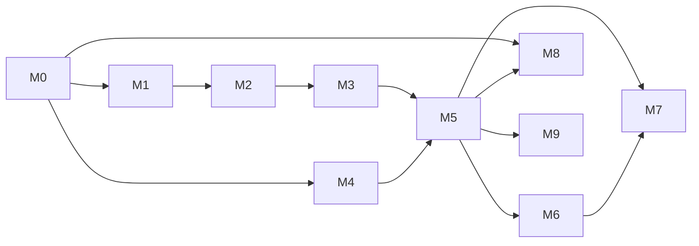

# Master plan

How Waiter-Bot is rebuilt for ROS 2 Jazzy and Gazebo Harmonic: ten milestones, each with its own plan file, sub-task checklist, and test gate. Design background is in [../architecture.md](../architecture.md). Requirement IDs (R1 to R7) are in [../requirements.md](../requirements.md). Test IDs are in [../test_plan.md](../test_plan.md).

## Milestones

| # | Milestone | Delivers | Gate | Plan |
|---|---|---|---|---|
| M0 | Workspace and interfaces | Clean repository, package skeletons, messages, action, services, lint | S1, S2, S5, S8 | [M0](M0_workspace_interfaces.md) |
| M1 | Robot | `waiter_bot` Xacro for Harmonic, bridges, an empty-world launch | S3, N1 on an empty world | [M1](M1_robot.md) |
| M2 | World and map | Café world, location table, saved map | S3, S4 | [M2](M2_world_map.md) |
| M3 | Navigation | Nav2 on Jazzy with AMCL and the map; trips between locations | N1 to N5 | [M3](M3_navigation.md) |
| M4 | Task logic | `butler_fsm` and the `butler_task_manager` node | T1 to T24, TN1 to TN9, S6 | [M4](M4_task_logic.md) |
| M5 | Integration | Whole-system launch, scenario runner, scenarios for R1 to R7 | E1 to E9 | [M5](M5_integration.md) |
| M6 | Dashboard and visuals | Qt dashboard, RViz markers | MAN2 | [M6](M6_dashboard.md) |
| M7 | Documentation and demo | README, per-requirement walkthroughs, recordings | MAN3 | [M7](M7_docs_demo.md) |
| M8 | Docker and CI | Image, Compose services, GitHub Actions | DK1 to DK5 | [M8](M8_docker.md) |
| M9 | Stretch | Order queue, nearest-first ordering, behaviour tree, lifecycle node, battery | Optional | [M9](M9_stretch.md) |

## Order and dependencies

M4 depends only on the interfaces from M0. Its tests need no simulator, so it is built **before** the simulation work. This is deliberate: the first submission spent its time on what can be seen and never built the part that is graded. Nothing in M1 to M3 can break the behaviour, because the behaviour is already proven.

Order for one person: M0, M8 (first image), M4, M1, M2, M3, M5, M6, M8 (finish), M7, then M9 if time remains.

## Workflow

- Documents go to `main` first (this planning branch). After that, **one branch per milestone**, merged into `main` before the next starts. Later fixes also get a branch.
- Per milestone: implement, test, commit, review, fix, run the other checks. Then push, open the PR, merge.
- The **Result** section at the end of each milestone file records what was built, what was measured, and what changed from the plan. It is the "documented approach" for that milestone.
- Commits are small and named for the change. Every milestone's last commit ticks its checklist.

## Requirement traceability

| Requirement | Built in | Proven by |
|---|---|---|
| R1 single order, no confirmation | M4, M5 | T1, T2, E1 |
| R2, R3a no kitchen confirmation, home after timeout | M4, M5 | T3, T10, E2 |
| R3b no table confirmation, kitchen then home | M4, M5 | T4, E3 |
| R4a cancel on the way to the kitchen, home | M4, M5 | T5, T10, E4 |
| R4b cancel on the way to a table, kitchen then home | M4, M5 | T6, T11, TN6, E5 |
| R5 several orders, home after all delivered | M4, M5 | T7, E6 |
| R6 one table ignored, continue, kitchen then home | M4, M5 | T8, E7 |
| R7 one table cancelled, skip, kitchen then home | M4, M5 | T9, TN3, E8 |
| Runs in ROS | M1 to M5 | N1 to N5, E1 to E9 |
| Generic, not hardcoded | M4, M5 | TN1, E9 |
| Clean, documented, a push per milestone | M0, M7 | S5, S8, MAN3, this file |
| Presentation and innovation | M5, M6, M9 | Scenario runner, MAN2 |

## Definition of done

For any milestone:

- Every sub-task in its plan file is checked off, and the **Result** section is written.
- Its gate tests pass, and earlier gates still pass.
- Every function has a short docstring saying what it does and how it serves delivering orders (project convention; review checks it).
- The documents under `docs/` match the code, including parameter defaults in [../interfaces.md](../interfaces.md).

For the project: M0 to M7 done, M8 done, and E1 to E9 pass three runs in a row.

## Risks

| Risk | Likelihood | Effect | Response |
|---|---|---|---|
| Four-wheel skid steer behaves badly in Gazebo (slip, bad odometry) | Medium | Navigation drifts, AMCL fails | M1 measures turn accuracy. Fallback: two driven wheels plus frictionless casters |
| Nav2 lifecycle start-up timing makes end-to-end tests flaky | High | False failures | A wait-for-active helper in the harness. Tests wait for the `/navigate_to_pose` server and AMCL pose, not for fixed sleeps |
| Nav2 recovery behaviours make trips slower than the 20 s confirmation timeout | Low | Timeouts misfire | The timeout starts on arrival, not on goal send. Parameters are adjustable per scenario |
| Headless rendering fails for the lidar | Low | Tests cannot run unattended | Try software rendering. The lidar needs `ogre2`; check in M1 |
| `rclpy` callbacks deadlock under the multi-threaded executor | Medium | Hung goals | Separate callback groups, no blocking calls (see architecture section 6). TN tests cover cancel and timeout paths |
| Asset conversion makes the world look worse than the old one | Medium | Presentation suffers | Time-box M2. Primitive shapes are acceptable; meshes are an upgrade |
| Nav2 on Jazzy changes `Twist` to `TwistStamped` in a patch release | Low | Robot does not move | Check the type in M3 before wiring the bridge |
